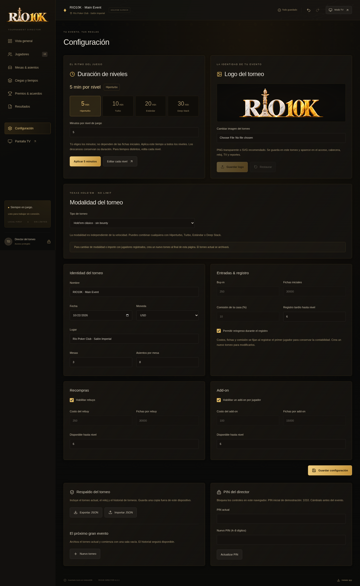
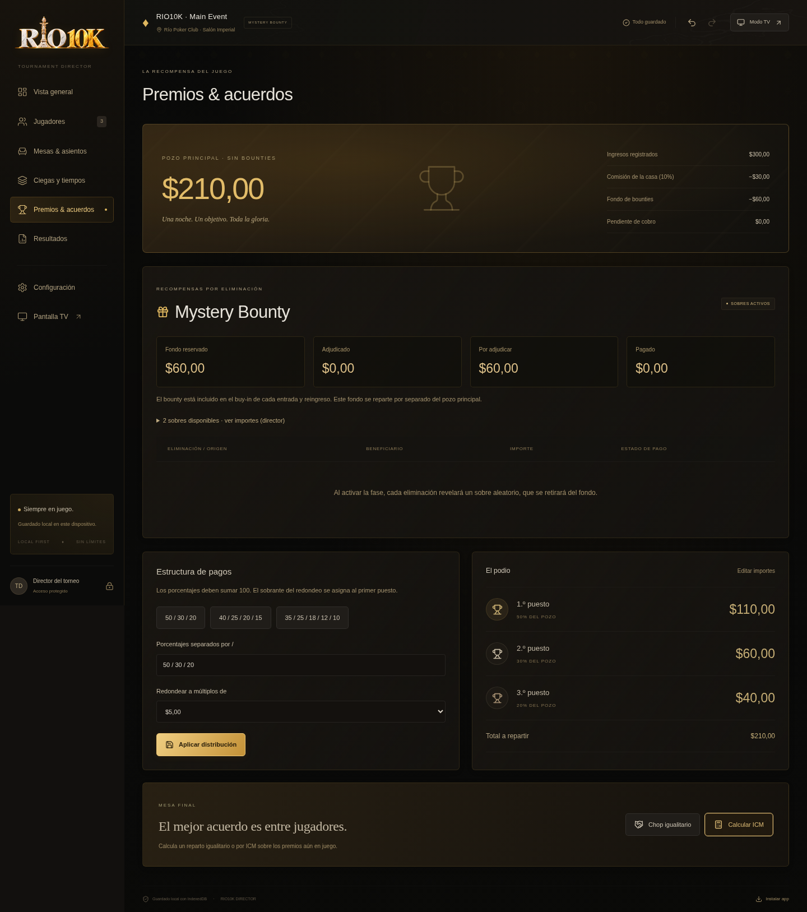

# RIO10K para Windows

Aplicación local portátil para dirigir tu torneo de Texas Hold’em. Incluye el runtime oficial de Node.js; no necesitas instalar Node, npm ni una clave API.

## Edición negro, dorado y mármol

La aplicación usa los colores del afiche proporcionado y una adaptación de su logo central con fondo transparente. El logo grande se muestra como marca de agua detrás del reloj y también aparece en acceso, TV, iconos y reportes. Para una reproducción exacta se puede reemplazar por el PNG transparente o SVG original del organizador.


## Versión 1.1.1: tiempos, modalidades y logo

**El tiempo por nivel lo eliges tú; no depende de las fichas.** Se encuentra al principio de **Configuración → Duración de niveles**. Por ejemplo, Hiperturbo aplica 5 minutos a cada nivel de juego. Para minutos distintos por fila usa **Ciegas y tiempos → Duración (min)**.

Esta actualización corrige el iniciador: si hay otra versión ejecutándose, avisa cómo cerrarla en lugar de abrirla silenciosamente. Se comprobó la actualización con caché antigua: torneo, jugadores, reloj y PIN se conservan, y la nueva versión vuelve a abrir sin internet.

- **Configuración → Duración de niveles**: 5, 10, 20 o 30 minutos y duración personalizada de 1 a 180. Los descansos conservan su tiempo. Aplicar pausa y reinicia el nivel actual, con confirmación.
- **Ciegas y tiempos**: duración editable por cada nivel; plantillas Hiperturbo (5 min), Turbo (10 min), Estándar (20 min) y Deep Stack (30 min).
- **Configuración → Modalidad**: Hold’em clásico, KO fijo o Mystery Bounty. Se combinan con cualquier velocidad. Para cambiar modalidad con la demo ya registrada, crea un Nuevo torneo; la demo se archivará.
- **KO fijo**: el bounty está incluido en cada buy-in/reingreso y se contabiliza aparte del pozo principal. Se adjudica al eliminador y se registra su pago. El campeón conserva su propio bounty.
- **Mystery Bounty**: configura un nivel posterior al cierre del registro. En Premios & acuerdos prepara un sobre por eliminación restante; todos deben sumar el fondo reservado. Cada eliminación de la fase retira un sobre aleatorio, sin reemplazo. Las entradas/reingresos quedan cerrados. Si finalizas antes de activar la fase, la confirmación informa que el fondo irá al campeón.
- **Configuración → Logo del torneo**: elige tu PNG transparente, SVG, JPG o WebP, revisa la vista previa y guarda. Se aplica al acceso, reloj, TV y reportes y viaja en el respaldo JSON.
- Deshacer/rehacer incluye recompensas, sorteos y pagos. Los respaldos antiguos se migran conservando el reloj, el PIN y los jugadores.





Comprobado: 70 pruebas del motor y guardado, 12 del iniciador; recorridos de navegador para duración, logo persistente, KO, Mystery, deshacer/rehacer, reportes y operación offline.

## Descargar

1. Abre [RIO10K-Windows.zip](./RIO10K-Windows.zip).
2. Pulsa el icono **Download raw file** (flecha hacia abajo) de GitHub. Si el repositorio es privado, inicia sesión con la cuenta que tiene acceso.
3. En Windows, haz clic derecho sobre el ZIP y selecciona **Extraer todo**. No ejecutes el iniciador desde dentro del ZIP.
4. Abre la carpeta `RIO10K` y haz doble clic en **ABRIR-RIO10K.bat**.
5. Entra con el PIN inicial **1010** y cámbialo en Configuración.

**[Enlace directo al ZIP](https://github.com/edudu7447/gpt-edu1/raw/refs/heads/descarga-rio10k-windows/RIO10K-Windows.zip)**

Mantén abierta la ventana del iniciador mientras diriges el torneo; puedes minimizarla. Con Chrome o Edge, la app se abre como una ventana independiente. Si el navegador no se abre automáticamente, abre `http://127.0.0.1:4178` en el equipo donde ejecutaste el iniciador.

## Actualizar una instalación anterior

1. Exporta primero un respaldo JSON desde Configuración.
2. Cierra las ventanas RIO10K/TV. En la ventana del iniciador anterior pulsa **Ctrl+C** para apagar ese servidor.
3. Extrae el nuevo ZIP en otra carpeta y abre su **ABRIR-RIO10K.bat**. La ventana del iniciador debe indicar **RIO10K v1.1.1**.
4. Usa el mismo navegador/perfil; el origen sigue siendo http://127.0.0.1:4178, por lo que tus datos se conservan.
5. Si aparece la pantalla anterior, pulsa **Ctrl+F5** en la ventana de RIO10K para recargarla. Espera unos segundos, cierra todas las ventanas RIO10K/TV y vuelve a abrir el iniciador nuevo. En el pie de la app debe decir **v1.1.1**. **No borres los datos del sitio**.

## Datos y respaldos

El torneo funciona sin internet y se guarda en el mismo navegador/perfil del equipo. Exporta respaldos JSON desde Configuración. No uses modo incógnito ni borres los datos del sitio si quieres conservarlo. Para pasar el torneo a otro equipo, exporta e importa el JSON.

Incluye jugadores ficticios para probar. En Configuración → Nuevo torneo puedes iniciar tu evento con la sala vacía.

## Compatibilidad y verificación

Paquete para Windows de 64 bits (Intel/AMD), con una versión de Windows compatible con Node.js 24 y un navegador moderno. La ejecución completa fue validada en Linux; el runtime Windows se verificó con el SHA-256 oficial de Node.js, pero no se ejecutó en Windows durante la preparación.

Archivo de aproximadamente 35 MiB. Puedes verificarlo en PowerShell:

```powershell
Get-FileHash .\RIO10K-Windows.zip -Algorithm SHA256
```

SHA-256:

```text
8f4d3f9d8ee1a60c6a7ff5deaaca8b4eb3d1a4b1176bd13f4c56625f6773000e
```

Esta rama contiene únicamente el paquete descargable y estas instrucciones. No cambia la aplicación ni los archivos de trabajo del proyecto.
